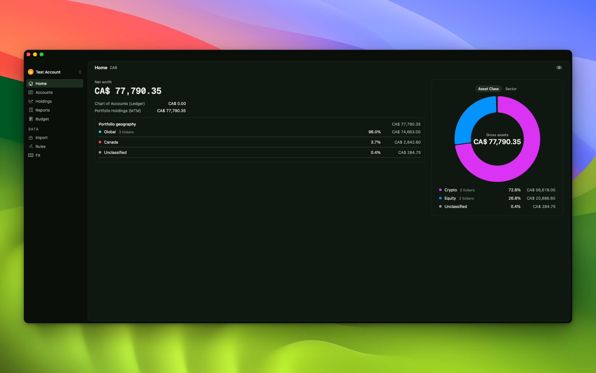

# appshot

Clean or "marketing-ready" screenshots of a running macOS app window.

`appshot` grabs an on-screen window and composites it onto a polished backdrop —
with rounded padding and soft shadows — ready for a README, a landing page, or the
Mac App Store. No manual cropping or drop-shadow fiddling.



## Usage

```
./appshot.swift <AppName> [options]
```

`<AppName>` is matched (case-insensitively, by substring) against the owner name
of on-screen windows. The largest matching window wins.

### Options

| Option               | Description                                                                |
| -------------------- | -------------------------------------------------------------------------- |
| `-o`, `--out <file>` | Output PNG (default: `<AppName>-screenshot.png`)                           |
| `--clean`            | Just the window, no background (transparent corners, no shadow)            |
| `--bg <spec>`        | Background (default: `gold`). See below.                                   |
| `--size WxH`         | Canvas size in px (default `2880x1800`, the Mac App Store 16:10 size)      |
| `--pad <0-0.4>`      | Padding around the window as a fraction of canvas (default `0.08`)         |
| `--tight`            | Mostly app, minimal background: pad `0.04` and scale the window up to fill |
| `--title <text>`     | Only match windows whose title contains this text                          |
| `--delay <sec>`      | Wait after activating the app (default `0.8`)                              |
| `--upscale`          | Allow scaling the window UP to fill the canvas (default: never upscale)    |
| `--no-activate`      | Don't bring the app to front first                                         |
| `--list`             | List on-screen windows and exit                                            |
| `--list-bgs`         | List available background presets and built-in macOS wallpapers            |

### Backgrounds (`--bg`)

- **Preset gradient** — `gold`, `aqua`, `sunset`, `purple`, `graphite`
- **Mesh gradient** — `sunrise`, `bubblegum`, `pastel`, `cosmic`, `cosmic-warm`, `mystic`, `midnight`, `goldglow`
- **Ribbed glass** — `glass-orange`, `glass-blue`, `glass-fire`
- **Custom** — `"#hex,#hex,#hex"` for a linear gradient, or a single `"#hex"`
- **Wallpaper** — `wallpaper` (your current macOS desktop picture), or `macos:<name>` for a built-in one (e.g. `macos:sequoia`)
- **Image** — any `/path/to/image` (aspect-filled)

### Examples

```sh
# Default gold backdrop at 2880x1800
./appshot.swift Arbor

# Transparent window only, no background
./appshot.swift Arbor --clean -o arbor.png

# Tight crop on a sunset gradient, custom size
./appshot.swift Arbor --bg sunset --size 1600x1000 --tight

# Use the current desktop wallpaper
./appshot.swift Arbor --bg wallpaper

# Pick a specific window of a running app
./appshot.swift --list
./appshot.swift Arbor --title "Settings"
```

## Requirements

- macOS with Xcode command line tools (`swift` / `swiftc`).
- **Screen Recording permission** for the app running the script
  (Terminal, iTerm, Ghostty, VS Code…):
  System Settings → Privacy & Security → Screen & System Audio Recording.
  After granting it, fully **quit and reopen** that app.

## Build

`appshot` is a single Swift file and can be run directly, but compiling it makes
startup much faster.

With the Makefile:

```sh
make            # build ./.build/appshot
make install    # build + install to ~/.local/bin (replaces the previous binary)
make uninstall  # remove installed binary and source copy
make clean      # remove build output
```

Override the install location with `make install PREFIX=/usr/local` (may need `sudo`).

Or compile directly:

```sh
swiftc -O appshot.swift -o appshot
```

Then run the binary:

```sh
./appshot Arbor
```

## License

[MIT](LICENSE) © 2026 Aqua Flamingo Labs Inc
